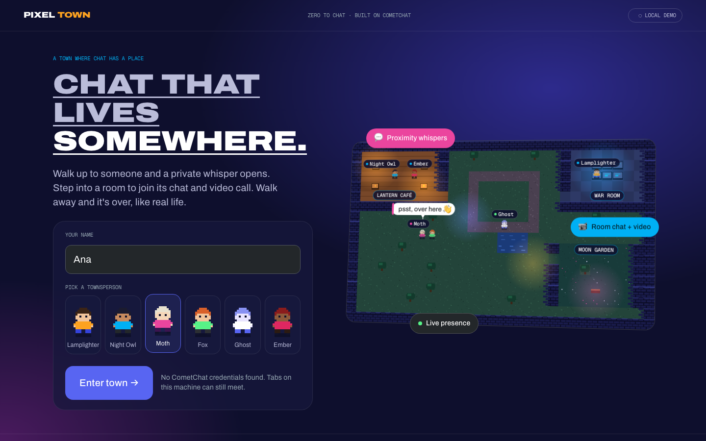
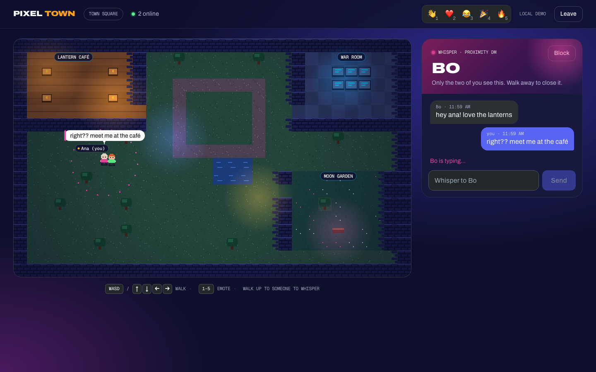
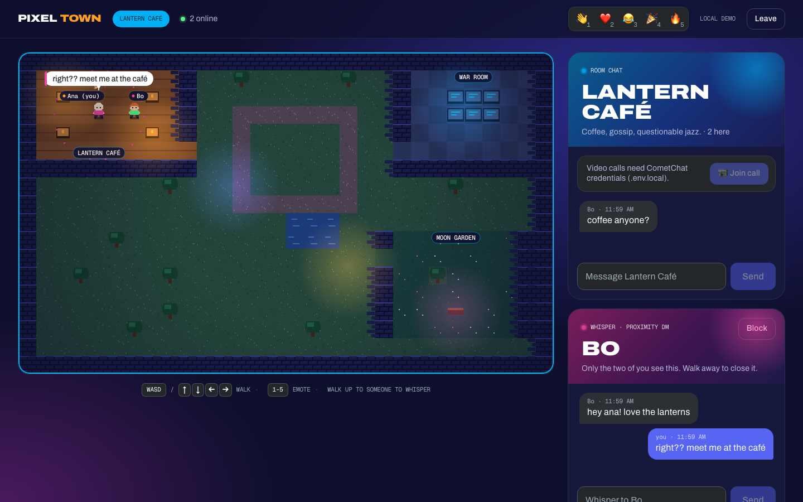

# Pixel Town

**Chat that lives somewhere.** Pixel Town is a pixel-art town where conversations have a place. Walk up to someone and a private whisper opens. Press **Call** and they ring. Step into a room and you're in its group chat and video call. Walk away, and it's over, like real life.

Built in two weeks for the [CometChat **Zero to Chat**](https://www.cometchat.com/hackathon) challenge with Claude Code and the CometChat MCP server. #ZeroToChat



## Features

| | |
| --- | --- |
| 🚶 **Walk around together** | Everyone in town sees everyone else move in real time, with names, emotes and presence. |
| 💬 **Proximity whispers** | Stand next to someone and a private 1:1 chat opens. Their typing shows as a bubble over their head. Walk away and it closes. |
| 📞 **Whisper calls** | Press **Call** (or `C`) to ring the person beside you. Accept and you're on 1:1 video. Walk out of range and the call hangs up. |
| 🏠 **Rooms** | Step into the Lantern Café, War Room or Moon Garden to join that room's group chat and one shared video call. Rooms show the current conversation (the last 15 minutes), not every message ever sent. |
| 🛡️ **Safety** | Block a player to hide them from your map and chats and stop their calls. Report messages to moderators on CometChat plans that include Moderation. Server moderation verdicts are honoured. |
| 📱 **Anywhere** | Keyboard, on-screen D-pad on touch screens, and a follow-camera on narrow phones. |

| Whisper, with typing over their head | Room chat and the shared call |
| --- | --- |
|  |  |

## How CometChat powers it

| In the town | CometChat |
| --- | --- |
| Avatars moving in real time, emotes | **Transient messages** to a `pixel-town-world` group (never stored; about 8 per second while walking) |
| Whispers and their history | **1:1 text messages** |
| "•••" bubble over someone's head | **Typing indicators** |
| Room chat | **Public groups**, joined when you walk in |
| Room video call | **Calls SDK v5**: everyone in the room joins the room's session |
| Whisper call | **Chat SDK ringing** (`initiateCall`, `acceptCall`, `rejectCall`, `endCall`) plus **Calls SDK v5** for the 1:1 video |
| People disappearing when they leave | **Presence** |
| Block, report, moderation | `blockUsers`, `flagMessage`, `onMessageModerated` |

## How the CometChat MCP was used

The CometChat MCP server is checked in at [`.mcp.json`](.mcp.json), so it connects automatically when you open this project in Claude Code. Every CometChat integration detail in this repo came from it:

- **Implementation bundles:** `js-sdk-messaging-basics`, `presence-and-typing` and `moderation-setup` set the init and login order, listener cleanup, typing debounce and moderation flow.
- **Doc pages fetched through the MCP:**
  - transient messages (the idea for streaming movement without storing it)
  - Calls SDK setup, authentication, join-session, events and ringing
  - groups, user management and error codes (for `ERR_UID_NOT_FOUND`, `ERR_GUID_NOT_FOUND` and `ERR_ALREADY_JOINED` handling)
  - AI moderation, flag message and block users

Two things the MCP docs didn't settle were checked against the live SDK:

- **Block results:** `blockUsers` returns `{ uid: { success: true } }`, not the documented `{ uid: "success" }`. The code accepts both.
- **Moderation on the free plan:** the free plan rejects `flagMessage` with "Moderation feature is not available", so the Report button hides itself.

## Quick start

You need Node 18+ and a free CometChat account (no card, 100 monthly active users included).

```bash
git clone <this repo> && cd pixel-town
npm install

# CometChat credentials: let the CometChat CLI create an app and fetch them…
npx @cometchat/skills-cli@3 auth login && npx @cometchat/skills-cli@3 provision run
# …the CLI writes .cometchat/config.json. Copy its values into .env.local:
cp .env.example .env.local   # VITE_COMETCHAT_APP_ID, VITE_COMETCHAT_REGION, VITE_COMETCHAT_AUTH_KEY

npm run dev                  # http://localhost:5173
```

Open **one normal window and one incognito window** (or two different browsers), pick names, and walk toward each other. Two tabs in the same browser profile share CometChat's stored login, so the second one would sign the first out.

**No credentials?** The app falls back to a local demo mode where tabs in the same browser meet over a `BroadcastChannel`. Add `?fresh=1` to the second tab so it gets its own identity. Chat, typing, rooms and blocking work offline; calls need CometChat. Force local mode any time with `?local=1`.

### Controls

| Key | Action |
| --- | --- |
| `WASD` / arrow keys | Walk |
| `1`–`5` | Emotes 👋 ❤️ 😂 🎉 🔥 |
| `C` | Call the person you're standing next to |

## Project structure

```
src/
├── lib/                  Pure, unit-tested logic
│   ├── world/            Map, collision, movement, proximity, camera, label placement, player store
│   ├── packet.ts         Validation of untrusted movement packets
│   ├── conversation.ts   Conversation keys, message merging, room history window
│   ├── moderation.ts     Moderation verdicts, visibility rules, block results
│   └── directCall.ts     Whisper-call state machine
├── transport/            One interface, two backends
│   ├── cometchat.ts      The real thing (CometChat Chat SDK)
│   └── local.ts          Offline BroadcastChannel stand-in
├── calls/callSession.ts  Calls SDK v5: lazy-loaded, one session at a time
├── hooks/                Game loop, conversations, safety, whisper calls, keyboard
└── components/           Lobby, world canvas, chat, calls, HUD, town
design/                   Design system and the critic-loop notes behind the visuals
e2e/                      Playwright tests (local and live CometChat)
```

### Design notes

- **Nothing from the network is trusted.** Movement packets are validated field by field. Emotes come from a fixed list. A packet that claims to come from a different user than the real sender is dropped, so nobody can move someone else's avatar.
- **Abuse limits:** each sender's packets are rate-limited, coordinates must fall inside the map, the player count is capped, and names are stripped of invisible and direction-changing characters.
- **Calls are serialised.** The Calls SDK holds one session at a time, so joins and hang-ups run through a single queue. On hang-up, the video container is parked off-screen until the SDK has finished, which avoids a crash in the SDK's layout code.
- **Light on the network:** while walking, positions go out at most every 120 ms. When idle, a heartbeat goes out every 2.5 s. A newcomer says hello and everyone answers immediately.
- **Fast to load:** the map is drawn once, sprites are generated in code (no image files), and the roughly 560 KB Calls SDK only downloads when someone joins a call.
- **Look and feel:** a Discord-inspired night palette framed like a gallery piece. Display type is Archivo Expanded Black, labels are Geist Mono. See [`design/`](design/).

## Testing

```bash
npm test          # 109 unit tests (Vitest)
npm run e2e       # 3 Playwright tests in local mode: whisper, typing, rooms, report, block, walking away
npm run e2e:live  # Opt-in, against your real CometChat app (needs .env.local)
```

The live suite uses Chromium's fake camera to run a whisper, room chat, a room video call (including hang-up and rejoin), a whisper call (ring, accept, video, walk away) and blocking. Each run creates 2 CometChat users, which count toward your plan's monthly active users.

## Before using this in production

This is a hackathon project. To ship it for real:

- **Login:** replace Auth Key login with Auth Tokens created on a server (`loginWithAuthToken`), and create users server-side. The Auth Key is bundled into the browser build, so treat it as public.
- **Security headers:** add a Content-Security-Policy that allows CometChat's API, WebSocket and Calls domains for your region.
- **Moderation:** reporting and automatic moderation need a CometChat plan that includes Moderation. Blocking works on every plan.

## Acknowledgements

Built with [Claude Code](https://claude.com/claude-code), the [CometChat MCP server](https://www.cometchat.com/docs) and the agents and skills from [everything-claude-code](https://github.com/affaan-m/everything-claude-code).
